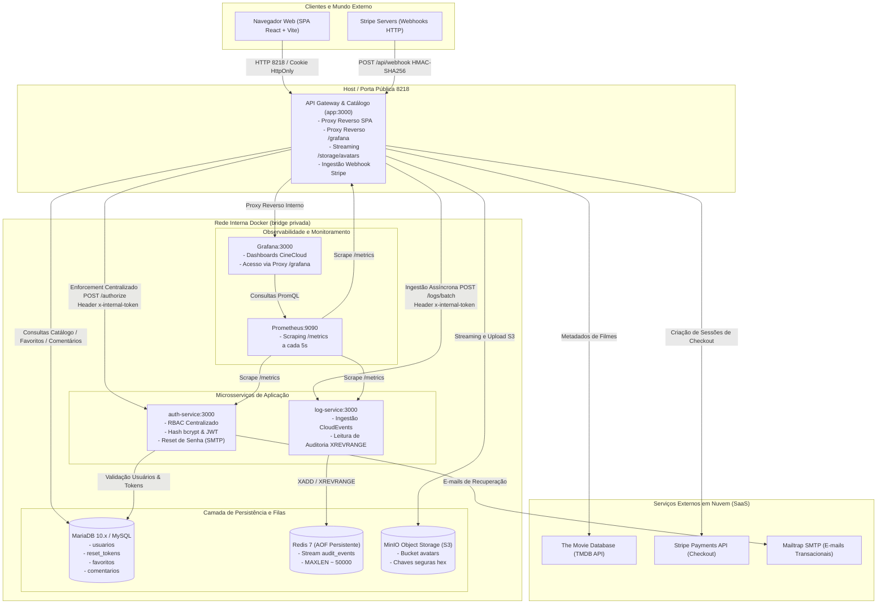
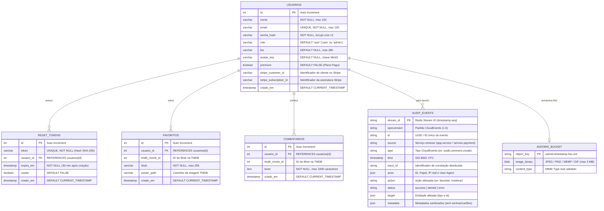
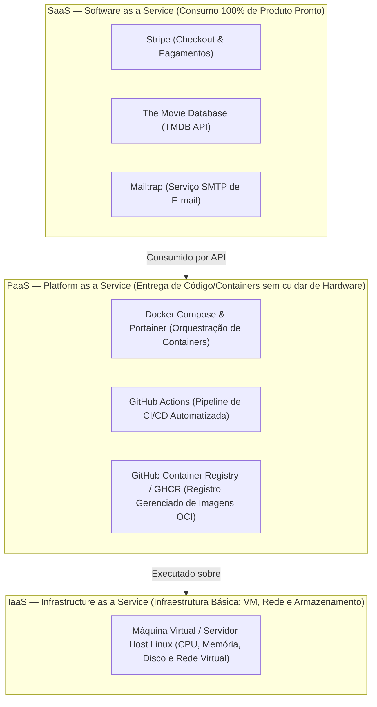

# Documentação Reversa do Sistema CineCloud
**Disciplina:** ISW055 — Introdução à Computação em Nuvem  
**Docente:** Prof. Allan Siriani ([github.com/siriani](https://github.com/siriani))  
**Autor:** Luis Gustavo Bonfim Ciaramicoli  
**Repositório Oficial:** [github.com/luisciaramicoli/cloud-atividade](https://github.com/luisciaramicoli/cloud-atividade)

---

## Sumário Executivo e Relatório de Handover

Este documento consolida a **documentação reversa integral** da plataforma **CineCloud**, elaborada a partir da auditoria estrita do código-fonte, configurações de infraestrutura conteinerizada e histórico evolutivo de commits dos últimos dois meses.

O objetivo deste dossiê técnico é permitir que qualquer engenheiro de software que venha a herdar ou manter o projeto compreenda com máxima precisão:
1. O que a aplicação entrega do ponto de vista do usuário final (Especificação Funcional);
2. A topologia completa de serviços e fluxos de dados distribuídos (Arquitetura do Sistema);
3. As restrições e regras aplicadas em tempo de execução no backend (Regras de Negócio "Se X, então Y");
4. A estrutura de persistência relacional, streams de eventos e object storage (Modelo de Dados);
5. A classificação de cada componente do sistema nas camadas de nuvem **SaaS, PaaS e IaaS**.

---

## 1. Especificação Funcional (Ponto de Vista do Usuário)

O **CineCloud** é uma plataforma web para cinéfilos com foco temático na filmografia do ator Tom Hanks, combinando recursos de catálogo, comunidade social, auditoria de segurança e modelo de monetização freemium/premium.

### 1.1. Autenticação, Cadastro e Gestão de Sessão
- **Cadastro de Conta:** O visitante pode criar uma nova conta informando Nome, E-mail e Senha. Toda conta pública é inicializada com o papel padrão de usuário comum (`role: 'user'`) e no plano gratuito (`premium: false`).
- **Autenticação Segura (Login):** O usuário acessa com seu e-mail e senha cadastrados. A credencial de acesso é emitida como um token JWT assinado criptograficamente (HS256) com validade de 2 horas e transmitida exclusivamente através de um cookie seguro com as diretivas `HttpOnly`, `SameSite=Lax` (e `Secure` em ambiente HTTPS). O frontend em React não armazena tokens em `localStorage`, mitigando riscos de roubo de sessão via ataques Cross-Site Scripting (XSS).
- **Validação Contínua de Sessão (`/api/me`):** Ao carregar ou recarregar a interface, a aplicação valida a sessão ativa com o backend através do cookie HttpOnly, recuperando o perfil do usuário sem expor dados confidenciais ao código JavaScript cliente.
- **Encerramento de Sessão (Logout):** Limpa o cookie de autenticação no cliente e finaliza a sessão no navegador.

### 1.2. Recuperação de Senha por E-mail
- **Solicitação de Recuperação ("Esqueci minha senha"):** O usuário informa seu e-mail. Caso o e-mail exista, o sistema gera um token criptográfico aleatório de 256 bits, calcula seu hash SHA-256 para gravação no banco de dados e dispara uma mensagem transacional via SMTP (Mailtrap) contendo o link exclusivo de redefinição.
- **Tempo de Expiração e Uso Único:** O link gerado possui validade de **30 minutos**. Ao emitir um novo link, tokens anteriores pendentes são revogados automaticamente. A resposta exibida na interface é propositalmente idêntica caso o e-mail exista ou não, impedindo a enumeração maliciosa de contas cadastradas.
- **Redefinição de Senha:** Na tela de reset, o usuário digita a nova senha (mínimo de 8 caracteres). O sistema valida a integridade do token, recalcula a chave bcrypt com 12 rounds e invalida o token para impedir reuso.

### 1.3. Catálogo de Filmes e Integração Externa (TMDB)
- **Consulta da Filmografia:** O usuário logado visualiza a lista completa de produções estreladas por Tom Hanks, contendo título, ano, visão geral (sinopse) e pôster oficial.
- **Filtros e Busca em Tempo Real:** Barra de busca instantânea com filtragem reativa por título e sinopse, além da opção de alternar a visualização entre "Todos os Filmes" e apenas "Meus Favoritos".
- **Alta Resiliência e Fallback Local:** O backend consome a API da The Movie Database (TMDB). Na eventualidade de ausência de chave de API, falha de conectividade ou indisponibilidade da TMDB externa, o backend chaveia de forma transparente para um catálogo fallback em memória, impedindo que a aplicação fique inoperante.

### 1.4. Lista Pessoal de Favoritos
- **Favoritar/Desfavoritar Filmes:** O usuário pode marcar ou desmarcar qualquer filme do catálogo com um único clique no ícone de estrela.
- **Persistência Individual:** A lista é isolada por conta de usuário no banco de dados. Um usuário jamais tem acesso ou visibilidade sobre os favoritos de outro usuário.

### 1.5. Comentários e Interação Social
- **Visualização de Comentários:** O usuário pode expandir o card de qualquer filme e visualizar os comentários cronológicos publicados por outros membros da comunidade, com nome do autor e data/hora.
- **Publicação:** Qualquer usuário autenticado pode comentar (até 1.000 caracteres).
- **Exclusão de Comentários pelo Autor:** O autor de um comentário visualiza o botão de lixeira e pode excluir o próprio comentário a qualquer instante.

### 1.6. Perfil Social e Upload de Foto (Object Storage MinIO)
- **Painel de Perfil (`/profile`):** Espaço dedicado para o usuário visualizar seus dados cadastrais, data de criação da conta, status do plano e filmografia favoritada.
- **Biografia Personalizada:** Campo de texto livre com limite de até 280 caracteres para apresentação social.
- **Upload de Avatar:** O usuário pode enviar sua foto de perfil (JPEG, PNG, WEBP ou GIF até 3 MB). O arquivo é transmitido para um Object Storage compatível com S3 (**MinIO**), gerando uma chave criptográfica única. Ao atualizar a foto, o backend remove automaticamente a imagem antiga para prevenir arquivos órfãos.
- **Exibição do Avatar:** A foto do perfil é servida pelo backend via streaming no endpoint `/storage/avatars/:filename`, aparecendo no cabeçalho do catálogo, na página de perfil e nos comentários.

### 1.7. Plano Premium com Cobrança Stripe
- **Modelo Freemium com Benefício Real:**
  - **Usuários Gratuitos:** Possuem uma cota máxima de **5 filmes favoritados**. Ao tentar adicionar o 6º favorito, o backend bloqueia a operação com **HTTP 403 Forbidden** e a interface exibe um modal explicativo de upgrade.
  - **Usuários Premium:** Possuem **favoritos ilimitados**, selo dourado **⭐ PREMIUM** no cabeçalho e página de perfil, e status de assinante ativo.
- **Checkout Seguro com Stripe (Modo de Teste):** Ao solicitar o upgrade (R$ 9,90/mês), o sistema cria uma Checkout Session oficial na Stripe e redireciona o usuário para a página de pagamento hospedada da Stripe.
- **Segurança PCI-DSS Total:** O CineCloud nunca recebe, transita ou armazena números de cartão de crédito, códigos CVV ou validade.
- **Ativação Assíncrona via Webhooks:** A confirmação do pagamento é notificada pela Stripe via Webhook assinado digitalmente (`stripe-signature` HMAC-SHA256). Ao validar o evento `checkout.session.completed`, o usuário é elevado automaticamente a `premium: true`.

### 1.8. Moderação e Painel Administrativo (Exclusivo para `admin`)
- **Moderação de Comentários:** Usuários com papel `admin` possuem poder de moderação em todo o catálogo. Podem apagar comentários impróprios publicados por qualquer usuário.
- **Gestão de Usuários:** Modal administrativo exibindo a lista consolidada de usuários cadastrados no banco de dados, seus papéis (`user`/`admin`), status de assinatura e datas de cadastro.

### 1.9. Trilha de Auditoria (Exclusivo para `admin`)
- **Painel de Auditoria em Tempo Real:** Administradores podem abrir a central de logs, que consulta a stream `audit_events` do Redis Streams através do microsserviço dedicado `log-service`.
- **Rastreabilidade Completa:** Exibe quem realizou a ação (ID, nome e IP real), qual ação foi disparada (login, exclusão, moderação, tentativa negada 403, upload, pagamento Stripe), status (`success`/`denied`) e metadados contextuais, em conformidade com as normas NIST SP 800-92 e ECS/CloudEvents v1.0.

### 1.10. Observabilidade e Métricas (Prometheus & Grafana)
- **Métricas Operacionais:** Rota interna `/metrics` exportando métricas de requisições, latências e saturação para o Prometheus.
- **Dashboard Grafana Integrado:** Rota `/grafana` servida via proxy reverso seguro embutido no gateway principal na porta 8218, restrita com autenticação e autorização RBAC para administradores.

---

## 2. Arquitetura do Sistema e Topologia de Nuvem

A arquitetura do **CineCloud** adota uma abordagem de microsserviços conteinerizados orquestrados via **Docker Compose**, comunicando-se em rede interna isolada (bridge) e expondo ao mundo externo apenas um ponto único de entrada (Porta `8218` mapeada para a porta interna `3000` do API Gateway / Catálogo).

### 2.1. Componentes e Papéis da Arquitetura

| Componente | Container / Serviço | Porta Interna | Porta Exposta | Papel Arquitetural |
|---|---|:---:|:---:|---|
| **API Gateway / Catálogo** | `app` | `3000` | `8218` | Porta de entrada única. Serve o frontend estático, despacha rotas de API, faz streaming de fotos do MinIO, consome a TMDB, inicia checkout na Stripe e faz proxy reverso seguro para o Grafana. |
| **Auth Microservice** | `auth` | `3000` | *Nenhuma (Interno)* | Responsável exclusivo pela regra de autenticação, hash de senhas, autorização RBAC centralizada (`POST /authorize`) e envio de e-mails de recuperação de senha. |
| **Log Microservice** | `log-service` | `3000` | *Nenhuma (Interno)* | Ingestão e consulta de eventos de auditoria normalizados no padrão CloudEvents v1.0 e ECS sobre o Redis Streams. |
| **Persistência Relacional** | MariaDB | `3306` | *Interna/Host* | Banco relacional onde residem tabelas de usuários, tokens de redefinição, favoritos e comentários. |
| **Broker de Eventos** | `redis` | `6379` | *Nenhuma (Interno)* | Redis 7 com AOF (Append-Only File) persistente em volume Docker para a stream `audit_events`. |
| **Object Storage** | `minio` | `9000` | *Nenhuma (Interno)* | Armazenamento de objetos compatível com Amazon S3 compilado do código-fonte, isolado internamente. |
| **Métricas** | `prometheus` | `9090` | `127.0.0.1:9090` | Coleta e armazena séries temporais dos endpoints `/metrics` dos microsserviços. |
| **Dashboards** | `grafana` | `3000` | `127.0.0.1:3001` | Visualização analítica acessada exclusivamente por administradores via subcaminho `/grafana` no Gateway. |

### 2.2. Protocolo de Segurança Inter-serviços
- **Isolamento de Portas:** Os containers `auth`, `log-service`, `minio` e `redis` não possuem mapeamento de portas para o host no Docker Compose. Eles são inalcançáveis pela internet aberta.
- **Autenticação com Segredo Compartilhado:** Todas as chamadas internas enviadas pelo Gateway para `auth-service` e `log-service` exigem o cabeçalho HTTP `x-internal-token`, derivado criptograficamente do `JWT_SECRET`. A verificação é realizada com proteção contra timing attacks através de `crypto.timingSafeEqual()`.

---

## 3. Regras de Negócio Extraídas do Código ("Se X, então Y")

Abaixo constam as regras de negócio reais aplicadas no backend, extraídas diretamente da análise do código-fonte:

### 3.1. Autenticação, Cadastro e Sessão
1. **Se** um usuário for cadastrado pelo endpoint público `POST /api/register`, **então** o papel atribuído será sempre `'user'` (impossibilitando que um usuário injete a role `admin` no payload) e o plano será gratuito (`premium: false`).
2. **Se** o nome de cadastro for vazio ou exceder 100 caracteres, **então** o backend rejeita com **HTTP 400 Bad Request**.
3. **Se** o e-mail não obedecer ao padrão regex de e-mail ou exceder 150 caracteres, **então** o backend rejeita com **HTTP 400 Bad Request**.
4. **Se** a senha fornecida no cadastro for menor que 8 caracteres ou maior que 72 bytes (limite de truncamento do algoritmo bcrypt), **então** o backend recusa com **HTTP 400 Bad Request**.
5. **Se** o e-mail informado no cadastro já existir na tabela `usuarios`, **então** o MariaDB dispara erro de unicidade (`ER_DUP_ENTRY`) e o backend retorna **HTTP 400 Bad Request** com mensagem `"Email já cadastrado"`.
6. **Se** o usuário enviar credenciais inválidas no login (seja porque o e-mail não existe ou a senha está errada), **então** o backend executa uma checagem de hash dummy com custo idêntico (`bcrypt.compare` com `DUMMY_HASH`) e devolve a resposta genérica **HTTP 401 Unauthorized** com `"E-mail ou senha incorretos"` (prevenindo enumeração de e-mails por análise de tempo de resposta).
7. **Se** o login for bem-sucedido, **então** o backend assina um token JWT com algoritmo HS256, validade de 2 horas e claims `{ id, email, role, premium }`, gravando-o no cookie seguro `token` com as flags `HttpOnly` e `SameSite=Lax`.
8. **Se** o endpoint exigir autenticação e nenhum token válido for localizado no cookie ou no cabeçalho `Authorization: Bearer`, **então** o middleware `authenticateToken` recusa com **HTTP 401 Unauthorized**.
9. **Se** o token JWT fornecido possuir assinatura violada ou data de expiração ultrapassada, **então** o middleware `authenticateToken` recusa com **HTTP 403 Forbidden**.
10. **Se** o endereço IP de origem enviar mais de 20 tentativas de autenticação em uma janela de 15 minutos, **então** o middleware `rateLimit` bloqueia temporariamente a origem com **HTTP 429 Too Many Requests**.

### 3.2. Recuperação de Senha
11. **Se** o endpoint `POST /api/forgot-password` for requisitado para qualquer e-mail, **então** o backend retorna sempre a mesma resposta com status **HTTP 200 OK** (`"Se o e-mail estiver cadastrado, enviaremos um link de recuperação"`), impedindo que invasores descubram quais usuários possuem cadastro.
12. **Se** o e-mail de recuperação de fato pertencer a um usuário ativo, **então** um token criptográfico aleatório de 256 bits é gerado, seu hash SHA-256 é registrado na tabela `reset_tokens` com validade de 30 minutos e todos os tokens pendentes anteriores deste mesmo usuário são marcados com `usado = TRUE`.
13. **Se** o usuário tentar redefinir a senha com um token que já foi marcado como utilizado (`usado = TRUE`), **então** o backend recusa com **HTTP 400 Bad Request** (`"Token já foi utilizado"`).
14. **Se** o usuário tentar redefinir a senha com um token cuja data atual seja posterior a `expira_em`, **então** o backend recusa com **HTTP 400 Bad Request** (`"Token expirado"`).
15. **Se** o token de redefinição for válido e não expirado, **então** a nova senha é cifrada com bcrypt (12 rounds), o registro do usuário é atualizado, o token é marcado como utilizado (`usado = TRUE`) e o backend retorna **HTTP 200 OK**.
16. **Se** um mesmo IP tentar solicitar recuperação de senha mais de 5 vezes dentro de 1 hora, **então** o rate limiter específico bloqueia novas tentativas com **HTTP 429 Too Many Requests**.

### 3.3. Catálogo de Filmes e Resiliência
17. **Se** a variável `TMDB_API_KEY` for nula, vazia ou igual a `'dummy'`, ou se a requisição externa à API da TMDB falhar por timeout ou erro 5xx, **então** o controlador de filmes ativa instantaneamente o catálogo fallback local em memória contendo 5 obras consagradas de Tom Hanks, garantindo que o catálogo permaneça disponível para navegação.
18. **Se** a API da TMDB retornar filmes com atributo `poster_path` nulo, **então** o backend descarta esses registros da listagem para assegurar a qualidade visual da grade de filmes.

### 3.4. Favoritos e Benefício do Plano Premium
19. **Se** um usuário no plano gratuito (`premium = false`) tentar adicionar um filme aos favoritos e já possuir 5 filmes favoritados no MariaDB, **então** o backend bloqueia a inserção, recusa a requisição com **HTTP 403 Forbidden** contendo `{ limitReached: true, maxFavorites: 5 }` e enfileira um evento de auditoria com status `denied` (`audit.favorite.limit_reached`).
20. **Se** um usuário no plano premium (`premium = true`) tentar adicionar um novo favorito, **então** o backend permite a inserção imediata sem qualquer teto de limite numérico.
21. **Se** o filme já estiver previamente na lista de favoritos do usuário, **então** a query com `ON DUPLICATE KEY UPDATE` atualiza os metadados do título sem duplicar o registro no banco.
22. **Se** o usuário solicitar a remoção de um favorito (`DELETE /api/favorites/:tmdb_movie_id`), **então** a instrução SQL `DELETE` filtra estritamente por `usuario_id = req.userId`, garantindo que um usuário nunca desmarque favoritos alheios.

### 3.5. Comentários e Moderação RBAC (Padrão A — Centralizado)
23. **Se** um comentário pertencer ao próprio usuário solicitante (`comment.usuario_id === req.userId`), **então** o autor tem autorização imediata para excluí-lo e o backend executa o delete com **HTTP 200 OK**.
24. **Se** o comentário pertencer a outro usuário (`comment.usuario_id !== req.userId`), **então** o catálogo realiza uma chamada de rede interna para `POST /authorize` no `auth-service` com `requiredRole: 'admin'`.
25. **Se** o `auth-service` responder que o usuário solicitante não possui o papel `'admin'`, **então** o catálogo rejeita a solicitação com **HTTP 403 Forbidden**, dispara um evento de auditoria de segurança com flush imediato (`tentativa_negada_403`) e preserva o comentário intacto.
26. **Se** o `auth-service` responder que o solicitante é `'admin'`, **então** o catálogo executa a exclusão por moderação com **HTTP 200 OK** e registra um evento de auditoria de moderação (`audit.comment.moderate`).
27. **Se** o texto de um comentário enviado for vazio ou ultrapassar 1.000 caracteres, **então** o backend recusa a inclusão com **HTTP 400 Bad Request**.

### 3.6. Perfil de Usuário e Upload de Foto (MinIO S3)
28. **Se** uma requisição de atualização de perfil (`PUT /api/users/:id/profile`) contiver no parâmetro da URL um ID diferente do ID autenticado no token JWT (`req.userId`), **então** o backend recusa a operação imediatamente com **HTTP 403 Forbidden** (`"Acesso negado: você só pode editar o seu próprio perfil"`), gerando log de violação de segurança imediato.
29. **Se** o usuário enviar uma nova foto de perfil, **então** o middleware `multer` e o validador de magic bytes conferem se o arquivo é imagem real (JPEG, PNG, WEBP ou GIF) com tamanho máximo de 3 MB. Arquivos com extensões forjadas ou executáveis são rejeitados com **HTTP 400 Bad Request**.
30. **Se** a foto for aprovada, **então** o backend gera uma chave de objeto opaca no formato `${userId}-${Date.now()}-${randomHex}.${ext}`, armazena o binário no bucket `avatars` do MinIO e programa a exclusão do avatar anterior do usuário no MinIO para evitar acúmulo de arquivos órfãos.
31. **Se** o texto de biografia enviado exceder 280 caracteres, **então** o texto é truncado para o limite de 280 caracteres.
32. **Se** um cliente solicitar a foto via `/storage/avatars/:filename` e o nome do arquivo não casar exatamente com o padrão regex estrito de chave gerada pelo sistema, **então** o endpoint retorna **HTTP 404 Not Found** (bloqueando ataques de Path Traversal `../`).
33. **Se** a imagem existir no MinIO, **então** o backend faz o streaming do objeto enviando cabeçalhos de proteção estrita `X-Content-Type-Options: nosniff` e `Content-Security-Policy: default-src 'none'; sandbox`, impedindo que um invasor execute scripts através de arquivos de mídia.

### 3.7. Pagamentos e Assinatura Stripe
34. **Se** o usuário já for assinante do Plano Premium (`premium: true`) e tentar iniciar uma nova Checkout Session (`POST /api/checkout`), **então** o backend recusa com **HTTP 400 Bad Request** (`"Você já é um assinante do Plano Premium!"`).
35. **Se** o serviço de pagamento Stripe não estiver configurado no servidor (`STRIPE_SECRET_KEY` ausente), **então** a rota responde com **HTTP 503 Service Unavailable**.
36. **Se** o webhook do Stripe (`POST /api/webhook`) for chamado em ambiente configurado sem o cabeçalho `stripe-signature` ou com assinatura HMAC-SHA256 inválida para o buffer bruto recebido (`req.rawBody`), **então** a requisição é rejeitada com **HTTP 400 Bad Request** (garantindo que terceiros nunca forjem confirmações de pagamento).
37. **Se** o webhook receber o evento validado `checkout.session.completed`, **então** o backend extrai o `client_reference_id`, atualiza o MariaDB marcando `premium = 1`, armazena os identificadores `stripe_customer_id` e `stripe_subscription_id`, e grava um CloudEvent imediato de ativação de plano na trilha de auditoria.
38. **Se** o webhook receber o evento `customer.subscription.deleted`, **então** o backend localiza o usuário pelo `stripe_subscription_id`, reverte o status para `premium = 0` (rebaixamento ao plano gratuito com cota de 5 favoritos) e emite log de auditoria de cancelamento.

### 3.8. Auditoria, Rede e Segurança de Borda
39. **Se** uma requisição gerar um evento comum de auditoria, **então** ela é enfileirada na memória do Gateway e despachada para o `log-service` em lotes assíncronos a cada 500 ms ou a cada 10 eventos acumulados (minimizando sobrecarga de rede).
40. **Se** a ação envolver negação de acesso ou falha de segurança (ex.: HTTP 403 Forbidden ou ativação financeira), **então** o evento é despachado com `immediate: true` sem aguardar a fila de lotes.
41. **Se** uma requisição de mutação de estado (POST, PUT, DELETE) trouxer o cabeçalho `Origin` com domínio diferente do host da requisição e não listado em `CORS_ORIGINS`, **então** o middleware `originCheck` recusa com **HTTP 403 Forbidden** (proteção em profundidade contra Cross-Site Request Forgery).
42. **Se** um cliente externo tentar acessar o endpoint `/metrics` do Prometheus pela internet, **então** o middleware `internalOnly` valida o IP e o cabeçalho `X-Forwarded-For`, recusando requisições públicas com **HTTP 404 Not Found**.
43. **Se** um usuário não-administrador tentar acessar a rota `/grafana` via navegador, **então** o proxy do Gateway verifica a permissão no `auth-service` e bloqueia o acesso com **HTTP 403 Forbidden**.

---

## 4. Modelo de Dados

O ecossistema CineCloud adota um modelo híbrido de persistência poliglota:
- **MariaDB / MySQL:** Armazenamento relacional transacional (ACID) para dados de usuários, sessões, catálogos e permissões.
- **Redis 7 (Redis Streams):** Armazenamento em log estruturado sequencial, imutável e de alta vazão para a trilha de auditoria e conformidade.
- **MinIO (Object Storage S3):** Armazenamento binário de objetos não estruturados (fotos de avatar dos usuários).

### 4.1. Diagrama Entidade-Relacionamento (ERD)

### 4.2. Dicionário de Dados das Tabelas Relacionais (MariaDB)

#### Tabela `usuarios`
Responsável pela persistência cadastral, perfil social, papéis de controle de acesso (RBAC) e estado financeiro de assinatura.

| Coluna | Tipo | Nulo | Chave | Descrição / Regra |
|---|---|:---:|:---:|---|
| `id` | `INT` | Não | PK | Identificador numérico primário do usuário (Auto Increment). |
| `nome` | `VARCHAR(100)` | Não | | Nome completo exibido no catálogo e comentários. |
| `email` | `VARCHAR(150)` | Não | UNI | E-mail corporativo/pessoal único utilizado para login. |
| `senha_hash` | `VARCHAR(255)` | Não | | Hash da senha gerado via `bcrypt` com fator de custo 12. |
| `role` | `VARCHAR(50)` | Sim | | Papel no controle de acesso: `'user'` (padrão) ou `'admin'`. |
| `bio` | `VARCHAR(280)` | Sim | | Biografia de perfil social editada pelo próprio usuário. |
| `avatar_key` | `VARCHAR(255)` | Sim | | Chave do objeto da foto de perfil armazenada no MinIO. |
| `premium` | `BOOLEAN` | Sim | | `0` (Falso / Plano Gratuito) ou `1` (Verdadeiro / Plano Premium). |
| `stripe_customer_id` | `VARCHAR(255)` | Sim | | ID do cliente na plataforma Stripe (`cus_...`). |
| `stripe_subscription_id` | `VARCHAR(255)` | Sim | | ID da assinatura recorrente na Stripe (`sub_...`). |
| `criado_em` | `TIMESTAMP` | Não | | Data e hora UTC em que o registro foi criado. |

#### Tabela `reset_tokens`
Armazena tokens temporários criptográficos para o fluxo de recuperação de senha.

| Coluna | Tipo | Nulo | Chave | Descrição / Regra |
|---|---|:---:|:---:|---|
| `id` | `INT` | Não | PK | Identificador único do registro (Auto Increment). |
| `token` | `VARCHAR(255)` | Não | UNI | Hash SHA-256 do token criptográfico de 256 bits gerado aleatoriamente. |
| `usuario_id` | `INT` | Não | FK | Referência estrangeira à tabela `usuarios(id)`. |
| `expira_em` | `TIMESTAMP` | Não | | Data limite de validade do token (definida para 30 minutos após emissão). |
| `usado` | `BOOLEAN` | Sim | | Flag booleana (`0` = pendente; `1` = já utilizado). |
| `criado_em` | `TIMESTAMP` | Não | | Data e hora de geração do token. |

#### Tabela `favoritos`
Registra os filmes marcados como favoritos pelos usuários autenticados.

| Coluna | Tipo | Nulo | Chave | Descrição / Regra |
|---|---|:---:|:---:|---|
| `id` | `INT` | Não | PK | Identificador único do registro (Auto Increment). |
| `usuario_id` | `INT` | Não | FK | Referência ao usuário proprietário do favorito. |
| `tmdb_movie_id` | `INT` | Não | | ID numérico do filme no serviço externo TMDB. |
| `titulo` | `VARCHAR(255)` | Não | | Título do filme em texto para exibição rápida e fallback. |
| `poster_path` | `VARCHAR(255)` | Sim | | Caminho relativo do arquivo de pôster oficial da TMDB. |
| `criado_em` | `TIMESTAMP` | Não | | Data e hora da adição aos favoritos. |
| *Constraint Composta* | `UNIQUE (usuario_id, tmdb_movie_id)` | | | Garante que um usuário não duplique o mesmo filme nos favoritos. |

#### Tabela `comentarios`
Armazena os comentários e interações dos usuários sobre as produções cinematográficas.

| Coluna | Tipo | Nulo | Chave | Descrição / Regra |
|---|---|:---:|:---:|---|
| `id` | `INT` | Não | PK | Identificador único do comentário (Auto Increment). |
| `usuario_id` | `INT` | Não | FK | Referência ao autor do comentário na tabela `usuarios(id)`. |
| `tmdb_movie_id` | `INT` | Não | | ID do filme correspondente na TMDB. |
| `texto` | `TEXT` | Não | | Conteúdo do comentário em formato textual (até 1.000 caracteres). |
| `criado_em` | `TIMESTAMP` | Não | | Data e hora de publicação do comentário. |

### 4.3. Estrutura da Stream do Redis (`audit_events`)
A trilha de auditoria não utiliza tabelas SQL mutáveis. Ela é gravada no formato sequencial de chave-valor na stream `audit_events` com truncamento circular amortizado (`MAXLEN ~ 50000`) garantido pelo Redis 7 com persistência AOF em disco:
- **Formato do Evento:** JSON encapsulado sob o campo `event` do Redis Stream.
- **Campos Obrigatórios:** `specversion`, `id`, `source`, `type`, `time`, `actor` (`{ id, role, ip, user_agent }`), `action`, `status` (`'success'` ou `'denied'`), `target` e `metadata`.
- **Sanitização Prévia:** Chaves sensíveis (`senha`, `password`, `token`, `secret`, `jwt`, `authorization`) são mascaradas como `"[REDACTED]"` antes do envio para a stream.

### 4.4. Estrutura do MinIO Object Storage (`avatars`)
- **Bucket:** `avatars` (criado automaticamente na inicialização se inexistente).
- **Nomeclatura da Chave (`object_key`):** `${userId}-${timestamp}-${hex8}.${ext}` (ex: `1-1729000000000-a1b2c3d4.webp`).
- **Metadados Gravados:** `Content-Type` validado via buffer binário (não confia na extensão informada pelo cliente).
- **Isolamento de Leitura:** O bucket não é exposto diretamente na internet; o acesso ocorre exclusivamente através do proxy de streaming do backend em `/storage/avatars/:filename`.

---

## 5. Classificação SaaS, PaaS e IaaS da Pilha Completa

A computação em nuvem organiza as responsabilidades de infraestrutura em três camadas fundamentais (SaaS, PaaS e IaaS). O projeto **CineCloud** combina estrategicamente as três camadas de forma simultânea.

### 5.1. Matriz de Classificação do Projeto

| Componente do Sistema | Camada | Justificativa Técnica |
|---|:---:|---|
| **Servidor Host / Máquina Virtual (Linux)** | **IaaS** | O provedor de nuvem (datacenter da faculdade ou cloud provider) entrega recursos computacionais brutos (CPU virtualizada, memória RAM, disco e conectividade de rede). Toda a instalação e configuração do sistema operacional, pacotes do Linux, daemon do Docker, regras de firewall e particionamento de volumes são de responsabilidade do desenvolvedor. |
| **Docker Compose & Portainer Stack** | **PaaS** | Plataforma de execução conteinerizada que abstrai os detalhes físicos do sistema operacional hospedeiro. Nós empacotamos o código em imagens Docker e o Compose gerencia o ciclo de vida dos processos, políticas de reinicialização (`restart: always`), rede virtual em ponte (`bridge`), isolamento e checagem de saúde (`healthcheck`) dos 7 serviços. |
| **GitHub Actions (CI/CD)** | **PaaS** | Plataforma de automação e integração contínua totalmente gerenciada pela GitHub. Nós fornecemos apenas a especificação do workflow em arquivo YAML (`.github/workflows/ci-cd.yml`), e a GitHub provê os runners descartáveis, execução de testes automatizados e compilação das imagens sem necessidade de gerenciar servidores dedicados de build. |
| **GitHub Container Registry (GHCR)** | **PaaS** | Serviço gerenciado de registro de artefatos OCI da GitHub (`ghcr.io/luisciaramicoli/...`). Nós publicamos as imagens conteinerizadas prontas com tags imutáveis e o provedor cuida da disponibilidade, escalabilidade, segurança e armazenamento das camadas das imagens. |
| **Stripe (API de Pagamentos & Checkout)** | **SaaS** | Software como serviço completo para processamento financeiro. A Stripe entrega uma solução pronta e homologada PCI-DSS, cuidando das conexões com bandeiras de cartão, adquirentes e bancos. O CineCloud apenas consome a API REST para gerar a sessão de checkout e recebe notificações de eventos via webhook, sem gerenciar qualquer infraestrutura bancária. |
| **The Movie Database (TMDB API)** | **SaaS** | Produto pronto de catálogo de dados de entretenimento cinematográfico. Consumimos a base de dados mantida pela TMDB via requisições HTTP REST prontas para obter títulos, sinopses e imagens dos filmes de Tom Hanks, sem a necessidade de manter bases de dados de filmes ou crawlers próprios. |
| **Mailtrap (Serviço SMTP Transacional)** | **SaaS** | Serviço especializado de entrega e auditoria de e-mails transacionais. Consumimos o serviço via protocolo SMTP com credenciais de autenticação; o Mailtrap gerencia toda a infraestrutura de servidores de e-mail (MTA), caixas de entrada virtuais e regras de entregabilidade. |

---

## 6. Conclusão e Próximos Passos de Manutenção

Com a consolidação desta documentação reversa, a arquitetura do **CineCloud** encontra-se totalmente mapeada e desmistificada. O sistema atende rigorosamente aos padrões de:
- **Segurança da Informação:** Zero credenciais expostas no frontend, conformidade com PCI-DSS, rate limiting contra força bruta, proteção contra CSRF e sanitização estrita de entradas e saídas.
- **Observabilidade:** Métricas em tempo real raspadas pelo Prometheus e visualizadas no Grafana, combinadas a uma trilha de auditoria imutável via Redis Streams em conformidade com as diretrizes do NIST SP 800-92.
- **Engenharia de Software em Nuvem:** Desacoplamento entre serviços, comunicação autenticada em rede interna, modelo de dados normalizado e integração harmoniosa entre soluções IaaS, PaaS e SaaS.
