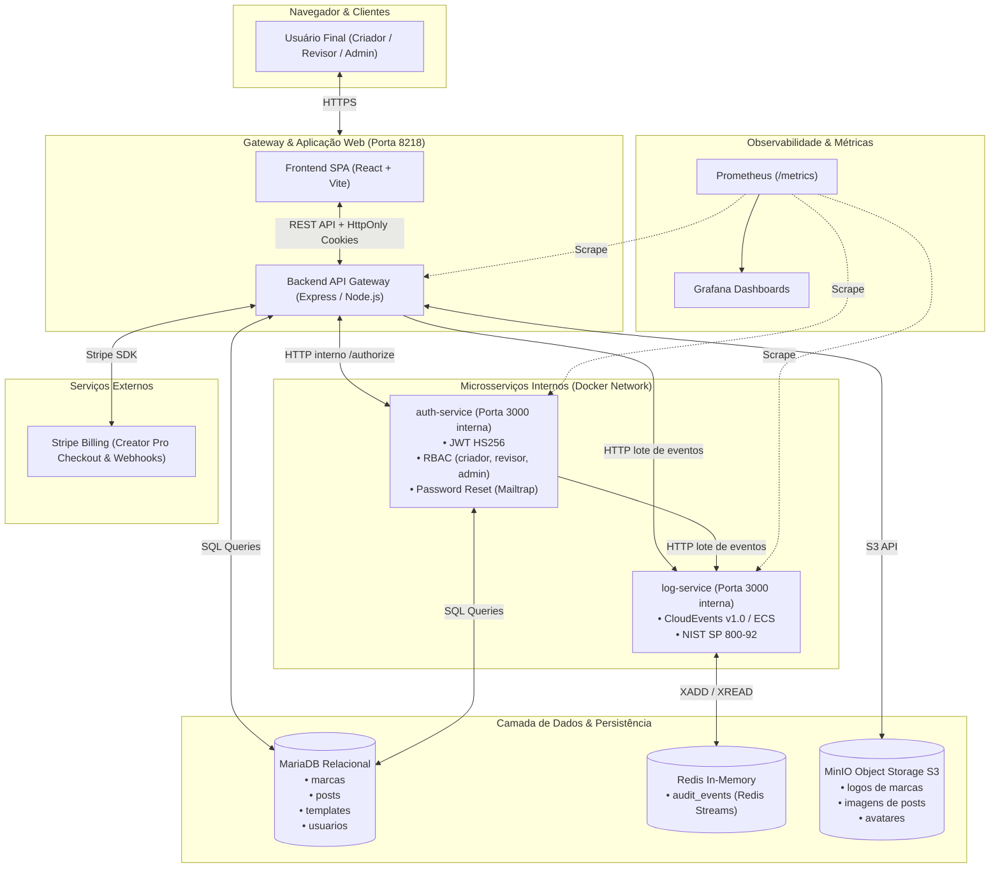

# PostCraft AI — Professor: [github.com/siriani](https://github.com/siriani)

> **ISW055 · Introdução à Computação em Nuvem (Fatec Pompeia)**  
> **Atividade 9 · Fork e Plano de Negócio de SaaS**  
> **Repositório do Produto:** [github.com/luisciaramicoli/postcraft-ai](https://github.com/luisciaramicoli/postcraft-ai)  
> **Repositório da Base (P1):** [github.com/luisciaramicoli/cloud-atividade](https://github.com/luisciaramicoli/cloud-atividade)

---

## 1. Nome e Frase

* **Nome do Produto:** **PostCraft AI**
* **Frase de Impacto:** Criação e agendamento inteligente de posts, carrosséis e legendas para Instagram com IA para autônomos e pequenos negócios que não têm tempo nem verba para contratar uma agência de marketing.

---

## 2. A Dor

### Quem sofre
Profissionais liberais autônomos (nutricionistas, psicólogos, dentistas, personal trainers, advogados e consultores) e proprietários de micro e pequenos negócios locais (clínicas, estúdios, confeitarias e comércio de bairro) que necessitam manter presença constante no Instagram para conquistar clientes e pacientes, mas não contam com equipe dedicada nem orçamento para agência.

### Quando acontece
Semanalmente, com pico crítico aos domingos à noite ou nos intervalos exaustivos entre atendimentos. É o momento em que o profissional se depara com a obrigação de planejar a grade semanal de publicações e é atingido pela "síndrome da tela em branco", sem saber o que postar, como estruturar o conteúdo ou como produzir uma arte visual atraente.

### Quanto custa hoje
* **Custo Financeiro Direto:** A contratação de um social media freelancer iniciante varia entre **R$ 800,00 e R$ 1.500,00 por mês**. Já uma agência de marketing digital cobra entre **R$ 2.000,00 e R$ 4.500,00 por mês**. Para um profissional autônomo com receita líquida de R$ 6.000 a R$ 10.000 mensais, esse gasto representa de 15% a 30% do seu faturamento bruto.
* **Custo em Tempo:** O autônomo gasta entre **8 a 12 horas semanais** (mais de um dia útil de trabalho por semana) pesquisando temas, escrevendo legendas, buscando fotos gratuitas e tentando alinhar elementos visuais no Canva.
* **Custo de Oportunidade e Risco:** Perfis com publicações esparsas ou amadoras sofrem queda drástica de alcance pelo algoritmo do Instagram. A ausência de constância transmite desorganização, resultando em perda direta de novos clientes para concorrentes com marketing ativo.

### Como resolvem hoje
1. **Canva Manual:** Tentam customizar modelos prontos. Como não dominam princípios de design, gastam horas ajustando fontes e cores, gerando artes desarmônicas e idênticas às de centenas de outros profissionais.
2. **ChatGPT ou Claude sem Integração:** Pedem ideias e legendas via prompt de texto. Embora a cópia textual seja útil, ainda precisam copiar manualmente, criar a arte visual do zero em outra ferramenta e recortar o texto para caber nas imagens.
3. **Improvisação ou Abandono:** Publicam apenas quando "sobra tempo" (fotos aleatórias com legendas superficiais) ou passam semanas inteiras em silêncio digital, minando a autoridade da sua marca.

---

## 3. Persona

* **Nome Fictício:** Dra. Camila Rocha
* **Idade:** 29 anos
* **Ocupação:** Nutricionista clínica autônoma em Marília/SP, atuando em consultório próprio e atendimentos virtuais.
* **Rotina diária:** Atende entre 5 e 7 pacientes por dia das 08h às 19h, elabora planos alimentares individualizados e tira dúvidas de pacientes via WhatsApp durante todo o expediente. Chega em casa por volta das 20h fisicamente e mentalmente fadigada.
* **O que ela tenta fazer:** Publicar de 4 a 5 conteúdos semanais no Instagram (carrosséis explicativos desmistificando dietas da moda, receitas rápidas e orientações sobre saúde intestinal) para atrair de 6 a 8 novos pacientes particulares por mês (ticket médio de R$ 250,00 por consulta).
* **O que a atrapalha:** Camila entende profundamente de bioquímica nutricional, mas não tem repertório de design nem redação publicitária. Ao abrir o Canva às 21h, passa mais de 2 horas tentando fazer um único carrossel: não sabe escolher tipografia, as fotos ficam pixeladas e os textos ficam longos e cansativos. Já contratou uma estagiária por R$ 500/mês, mas os posts vinham com erros conceituais de nutrição que manchavam sua reputação médica. Frustrada e sem tempo, ela abandona as postagens por semanas, assistindo sua agenda do mês seguinte esvaziar.

---

## 4. Concorrentes e Alternativas

| Concorrente / Alternativa | O que oferece | O que faz mal / Por que falha para a Persona |
|---|---|---|
| **Canva (Free / Pro)** | Biblioteca rica de templates e editor drag-and-drop. | **Exige trabalho 100% manual de diagramação.** Não elabora a estratégia de conteúdo, não escreve as legendas adaptadas ao nicho e exige horas de esforço manual de alinhamento e edição. |
| **ChatGPT / Claude (Puro)** | Geração de ideias, roteiros e legendas de alta qualidade textual. | **Não gera a imagem nem a arte pronta.** O usuário recebe um bloco de texto puro e continua com a dor de ter que abrir um editor visual, diagramar os slides do carrossel e montar a peça final. |
| **Agências de Marketing e Social Media Freelancers** | Produção completa de artes, legendas e agendamento. | **Custo proibitivo para autônomos (R$ 1.200 a R$ 3.500/mês),** ciclos lentos de aprovação (dias para alterar uma frase) e falta de conhecimento técnico sobre áreas regulamentadas (saúde, direito). |
| **Ferramentas Internacionais de Copy (Copy.ai, Jasper)** | Geração de posts e textos comerciais com IA. | **Focadas no mercado B2B corporativo em língua inglesa**, com cobrança em dólar (a partir de US$ 39/mês ~ R$ 230,00/mês) e sem integração visual com templates para Instagram brasileiro. |

---

## 5. Proposta de Valor

> *"Transforme uma ideia ou dúvida de cliente em um post ou carrossel profissional para o Instagram — com arte visual padronizada na identidade da sua marca, legenda persuasiva e hashtags de nicho — em menos de 60 segundos por uma fração do custo de um freelancer."*

---

## 6. Modelo de Receita com Stripe

O faturamento é 100% automatizado através do **Stripe Billing**, utilizando checkout seguro e gerenciamento automatizado de assinaturas via Webhook criptografado (HMAC-SHA256).

```
┌───────────────────────────────────────┐         ┌───────────────────────────────────────┐
│              PLANO FREE               │         │          PLANO CREATOR PRO            │
│               R$ 0,00                 │         │         R$ 49,90 / mês                │
│                                       │         │                                       │
│ • 3 posts com IA por mês              │         │ • GERAÇÃO ILIMITADA de posts e carrosséis│
│ • Legendas e hashtags automáticas     │ ──────> │ • Sem nenhuma marca d'água            │
│ • Marca d'água discreta               │ Stripe  │ • Identidade visual própria (logo/cores)│
│ • Até 10 arquivos no MinIO            │ Checkout│ • Biblioteca de prompts por nicho     │
│ • Formato padrão (1080x1080)          │         │ • Alta resolução (1080x1350 feed)     │
│                                       │         │ • Armazenamento ilimitado no MinIO    │
└───────────────────────────────────────┘         └───────────────────────────────────────┘
```

### Detalhamento dos Planos:

1. **Plano Free (R$ 0,00/mês — Gratuito para sempre):**
   * Limite de **3 posts gerados por IA por mês**.
   * Exportação com marca d'água discreta (*"Criado com PostCraft AI"*).
   * 1 perfil básico de marca.
   * Armazenamento de até 10 imagens geradas no bucket MinIO.
   * *Objetivo do Free:* Eliminar atrito de entrada e permitir que a persona comprove a qualidade em menos de 3 minutos. Ao atingir o 4º post ou querer remover a marca d'água, o usuário é direcionado para o Stripe Checkout.

2. **Plano Creator Pro (R$ 49,90/mês — Assinatura Recorrente Stripe):**
   * **Geração ILIMITADA** de posts individuais e carrosséis completos.
   * **Remoção de marca d'água**.
   * **Identidade Visual Automática:** Aplicação instantânea das cores da marca, fontes personalizadas e inserção do logotipo vetorial nos cards gerados.
   * **Prompts Especializados por Nicho:** Modelos pré-treinados para Saúde, Nutrição, Advocacia, Odontologia, Moda e Negócios Locais.
   * **Alta Resolução:** Formato retrato otimizado para o feed do Instagram (1080x1350) e Stories (1080x1920).
   * **Armazenamento Ilimitado** no MinIO com galeria histórica e download em lote.
   * *Por que alguém paga R$ 49,90:* O valor equivale a **menos de R$ 1,70 por dia** (menos que um cafezinho expresso) e representa uma fração insignificante do valor de uma única consulta da persona (R$ 250), economizando mais de 30 horas de trabalho manual por mês.

3. **Plano Agency / Multi-Perfis (R$ 149,90/mês — Upsell Futuro no Stripe):**
   * Até 5 marcas/perfis simultâneos.
   * RBAC para equipes (perfis de redator, designer e aprovador).
   * Exportação de calendário mensal completo em lote.

---

## 7. Métricas de Sucesso

As métricas são monitoradas continuamente para avaliar tração, viabilidade econômica e retenção:

1. **Novos Cadastros (Sign-ups):** Meta de 400 novos cadastros nos primeiros 60 dias de operação.
2. **Taxa de Ativação:** 65% dos novos usuários cadastrados gerando pelo menos 1 post nos primeiros 10 minutos após o login.
3. **Taxa de Conversão Free → Pro:** 6% a 8% dos usuários ativos no plano Free convertendo para o plano pago Creator Pro via Stripe.
4. **MRR (Monthly Recurring Revenue):**
   * *Mês 1:* R$ 1.500,00 (~30 assinantes Pro).
   * *Mês 3:* R$ 5.000,00 (~100 assinantes Pro).
   * *Mês 6:* R$ 15.000,00 (~300 assinantes Pro).
5. **Churn Rate Mensal:** Abaixo de 5% ao mês, mantido pela dependência positiva da ferramenta para a rotina semanal de postagens.
6. **LTV (Lifetime Value):** Estimado em R$ 499,00 por cliente (permanência média de 10 meses).

---

## 8. Lean Canvas

| Bloco | Resposta Estratégica do PostCraft AI |
|---|---|
| **1. Problema** | • Falta de tempo e repertório de design para criar posts frequentes no Instagram.<br>• Alto custo de agências e freelancers (R$ 800 a R$ 2.500/mês).<br>• Bloqueio criativo e dificuldade de diagramar carrosséis visuais a partir de textos puros.<br>• *Alternativas atuais:* Canva manual, ChatGPT com cópia manual, freelancers esporádicos. |
| **2. Segmentos de Clientes** | • **Público Principal:** Profissionais liberais autônomos (nutricionistas, médicos, psicólogos, dentistas, personal trainers e advogados).<br>• **Público Secundário:** Donos de microempresas e pequenos comércios locais.<br>• **Early Adopters:** Nutricionistas e psicólogos recém-formados com consultório próprio que precisam de clientes e não têm verba para agência. |
| **3. Proposta Única de Valor** | *"Artes, carrosséis e legendas profissionais para o Instagram gerados por IA em menos de 60 segundos, com a identidade visual do seu negócio e por menos de R$ 1,70 por dia."* |
| **4. Solução** | 1. **Gerador de Conteúdo com IA:** Geração contextualizada de tema, roteiro de slides e legenda com hashtags a partir de uma palavra-chave.<br>2. **Motor de Renderização Visual Automático:** Diagramação instantânea dos cards com aplicação de paleta de cores e logotipo.<br>3. **Biblioteca de Nicho:** Modelos validados por área de atuação prontos para exportação. |
| **5. Canais** | • Anúncios direcionados no Instagram (Meta Ads) demonstrando a criação de um post em 30 segundos.<br>• Conteúdo orgânico no próprio Instagram e Reels mostrando o "antes e depois" da ferramenta.<br>• Parcerias com conselhos regionais, cursos de formação e influenciadores de nicho profissional.<br>• Programa de indicação ("Indique um colega e ganhe 1 mês de Pro"). |
| **6. Fontes de Receita** | • Assinatura mensal **Plano Creator Pro** a R$ 49,90/mês via Stripe Billing.<br>• Assinatura mensal **Plano Agency** a R$ 149,90/mês para múltiplos perfis.<br>• Pacotes avulsos de créditos de geração de IA para usuários Free via Stripe Payment Intents. |
| **7. Estrutura de Custos** | • Custos de infraestrutura cloud (VPS, Portainer, MariaDB, Redis, MinIO): ~R$ 120,00/mês.<br>• Consumo de API de Inteligência Artificial (OpenAI / Gemini API por token/imagem gerada): ~R$ 0,08 por post completo.<br>• Taxas de processamento do Stripe: 3,99% + R$ 0,39 por transação aprovada.<br>• Custos de aquisição de clientes (Meta Ads). |
| **8. Métricas-Chave** | • Número de posts gerados por usuário ativo semanal (WAU).<br>• Taxa de conversão Free → Pro no Stripe.<br>• Receita Recorrente Mensal (MRR) e Churn Rate.<br>• Custo de Aquisição de Cliente (CAC) vs. Lifetime Value (LTV). |
| **9. Vantagem Injusta** | • Integração ponta-a-ponta entre geração textual, diagramação gráfica vetorial e armazenamento em nuvem no mesmo clique (o usuário não precisa abrir outra ferramenta).<br>• Biblioteca de prompts calibrados para conformidade ética de conselhos de classe profissionais brasileiros (CFN, CFM, OAB, CFP). |

---

## 9. Mapa de Reaproveitamento da Arquitetura

Toda a arquitetura de microsserviços e componentes distribuídos desenvolvida na primeira fase do projeto foi preservada e reposicionada estrategicamente para servir ao domínio do SaaS:

| Peça do Projeto Atual (CineCloud) | O que vira no SaaS (PostCraft AI) | Aplicação Concreta no Novo Domínio |
|---|---|---|
| **Catálogo de Filmes (TMDB API)** | **Feed & Galeria de Posts e Templates de IA** | Em vez de buscar filmes do Tom Hanks, o backend consulta e gerencia posts gerados, carrosséis, histórico de publicações e templates categorizados por nicho de mercado. |
| **Microsserviço de Login + RBAC (`auth-service`)** | **Gestão de Identidade, Perfis e Controle de Papéis** | Papéis de negócio: `usuario` (cria seus posts, edita seu perfil de marca e gerencia sua assinatura) e `admin` (modera conteúdos abusivos, audita consumo de tokens de IA e visualiza métricas globais de faturamento). |
| **Logs e Auditoria com Redis (`log-service`)** | **Auditoria de Eventos de Negócio e Consumo de IA** | Eventos orientados a domínio no formato CloudEvents v1.0 / ECS: `"post.generated"`, `"post.downloaded"`, `"brand.updated"`, `"subscription.activated"`, `"ai.token_limit_exceeded"`. |
| **Upload e Perfil com MinIO (Object Storage S3)** | **Armazenamento de Ativos de Mídia e Artes Geradas** | Armazena a foto de perfil do usuário, upload de arquivos de logotipo (PNG transparente) e a persistência em alta resolução dos cards e carrosséis gerados para download. |
| **Plano Premium com Stripe** | **Assinatura Recorrente Creator Pro (R$ 49,90/mês)** | Checkout Session hospedado e Webhook seguro (HMAC-SHA256). Ao confirmar o pagamento do plano Pro, a cota de 3 posts é liberada para ilimitada e a marca d'água é removida do renderizador. |
| **Documentação Interativa Swagger / OpenAPI 3.0** | **Documentação da API de Geração de Conteúdo** | Documentação interativa cobrindo os endpoints `/api/posts`, `/api/generate`, `/api/brands`, `/api/templates` e `/api/webhooks/stripe`. |
| **Observabilidade (Prometheus + Grafana)** | **Monitoramento Operacional e Métricas de Negócio** | Dashboards com latência das chamadas para a API de IA, throughput de posts gerados por minuto, erros 4xx/5xx e contadores de assinaturas ativas. |
| **Pipeline de CI/CD (GitHub Actions + GHCR)** | **Esteira de Entrega Contínua dos Microsserviços** | Build automatizado dos contêineres Docker, testes unitários e publicação no GitHub Packages com deploy contínuo via Watchtower no Portainer. |

---

## 10. Backlog de Entregas (GitHub Issues)

As seguintes 6 issues compõem o roteiro de implementação para as próximas atividades (Atividade 10 — Negócio no Ar e Atividade 11 — Assinatura Stripe):

### [Issue #1] Modelagem do banco relacional MariaDB para o domínio de Posts e Marcas
* **Tipo:** `backend`, `database`
* **Descrição:** Substituir o esquema de dados de filmes e favoritos pelas entidades do SaaS: tabelas `marcas` (nome, nicho, paleta_cores, logo_url), `posts` (titulo, formato, status, carrossel_json, prompt_utilizado, user_id), `templates` e `limites_usuario`.
* **Critérios de Aceitação:**
  * Script SQL de migração executando sem erros no MariaDB.
  * Relacionamento 1:N entre usuários e posts com integridade referencial.
  * Isolamento de dados garantindo que cada usuário só acesse suas próprias marcas e posts.

### [Issue #2] Microsserviço Backend: Módulo de IA para Geração de Conteúdo e Roteiros
* **Tipo:** `backend`, `feature`
* **Descrição:** Implementar serviço no backend que recebe o nicho, o tema desejado e a persona, consumindo a API de Inteligência Artificial para gerar o título do post, roteiro estruturado para carrossel (capa, slides explicativos e chamada para ação) e legenda com hashtags estratégicas.
* **Critérios de Aceitação:**
  * Endpoint `POST /api/generate/copy` autenticado via JWT.
  * Resposta estruturada em JSON contendo texto de cada slide, legenda completa e hashtags recomendadas.
  * Tratamento de falhas, timeouts e retry na chamada para a API externa de IA.

### [Issue #3] Pipeline de Renderização Visual e Persistência de Imagens no MinIO
* **Tipo:** `backend`, `storage`
* **Descrição:** Implementar motor de composição visual (via Node Canvas / SVG render) que transforma o roteiro gerado em cards gráficos (1080x1080 ou 1080x1350), aplicando a paleta de cores do usuário, logotipo salvo no MinIO e marca d'água condicional ao plano.
* **Critérios de Aceitação:**
  * Endpoint `POST /api/posts/:id/render` gerando arquivos PNG de alta resolução.
  * Salvamento das imagens geradas no bucket do MinIO com URLs assinadas ou públicas.
  * Aplicação de marca d'água nos posts de usuários do plano Free e sem marca d'água para usuários Pro.

### [Issue #4] Frontend React: Interface do Gerador de Posts e Preview do Feed
* **Tipo:** `frontend`, `ui/ux`
* **Descrição:** Reformular o frontend substituindo a listagem de filmes por um painel moderno contendo: formulário de entrada para o tema do post, seletor de nicho, editor com pré-visualização instantânea no mockup do feed do Instagram e botão de download do carrossel.
* **Critérios de Aceitação:**
  * Interface responsiva desenvolvida em React + Tailwind/CSS modular.
  * Componente de mockup simulando exatamente como o post ficará no Instagram.
  * Notificações visuais de loading durante a geração da IA.

### [Issue #5] Integração com Stripe Billing e Enforcement de Cotas por Papel
* **Tipo:** `backend`, `payment`
* **Descrição:** Atualizar o fluxo de pagamento para o plano Creator Pro (R$ 49,90/mês). Implementar middleware de verificação de cota: usuários do plano Free podem gerar até 3 posts por mês; ao tentar gerar o 4º, o sistema bloqueia e exibe modal com botão direto para o Stripe Checkout.
* **Critérios de Aceitação:**
  * Criação de Checkout Session com preço em BRL (R$ 49,90).
  * Webhook tratando eventos `checkout.session.completed` e `customer.subscription.deleted`.
  * Verificação rigorosa no backend antes de disparar chamadas para a API de IA.

### [Issue #6] Painel Administrativo de Moderação e Auditoria com Redis Streams
* **Tipo:** `backend`, `frontend`, `observability`
* **Descrição:** Adaptar o painel de administração acessível apenas para usuários com papel `admin` para visualizar métricas de consumo de tokens de IA, posts gerados na plataforma e relatórios de auditoria extraídos do Redis (`log-service`).
* **Critérios de Aceitação:**
  * Rota `/admin` restrita estritamente ao papel `admin` via RBAC.
  * Tabela em tempo real com eventos de auditoria capturados pelo Redis Streams.
  * Possibilidade de suspender usuários que violarem termos de uso ou gerarem conteúdo inadequado.


---

## 🚀 Atividade 10 · Seu Negócio no Ar (Implementação Concluída)

* **URL do Sistema no Ar:** `http://localhost:8218` (mesmo subdomínio da stack de produção)
* **Status da Stack:** 100% conteinerizada via Docker Compose no Portainer, limites de memória preservados.
* **Repositório do Produto:** [github.com/luisciaramicoli/postcraft-ai](https://github.com/luisciaramicoli/postcraft-ai)

### 1. Diagrama de Arquitetura de Microsserviços



### 2. Scripts de Migração e Seed do Banco de Dados
Os scripts SQL versionados estão localizados na pasta `db/`:
* [db/001_dominio.sql](db/001_dominio.sql) — Criação das tabelas `marcas`, `posts`, `templates` e expurgo de tabelas legadas.
* [db/002_seed.sql](db/002_seed.sql) — Inserção de templates de alta conversão para Nutrição, Direito e Fitness.

### 3. Matriz de Permissões RBAC (Enforcement Centralizado no Backend)

| Ação / Recurso | Método & Rota | Papel `revisor` | Papel `criador` | Papel `admin` |
|---|---|:---:|:---:|:---:|
| **Listar posts próprios** | `GET /api/posts` | ✅ Permitido | ✅ Permitido | ✅ Permitido (vê todos) |
| **Detalhar post próprio** | `GET /api/posts/:id` | ✅ Permitido | ✅ Permitido | ✅ Permitido |
| **Detalhar post de outro usuário** | `GET /api/posts/:id` | ❌ **403 Forbidden** | ❌ **403 Forbidden** | ✅ Permitido |
| **Criar novo post com IA** | `POST /api/posts/generate` | ❌ **403 Forbidden** | ✅ Permitido | ✅ Permitido |
| **Editar post existente** | `PUT /api/posts/:id` | ❌ **403 Forbidden** | ✅ Permitido (se dono) | ✅ Permitido |
| **Excluir post** | `DELETE /api/posts/:id` | ❌ **403 Forbidden** | ✅ Permitido (se dono) | ✅ Permitido |
| **Upload de Logo da Marca** | `POST /api/brands/:id/logo` | ❌ **403 Forbidden** | ✅ Permitido (se dono) | ✅ Permitido |
| **Acessar Trilha de Auditoria** | `GET /api/logs` | ❌ **403 Forbidden** | ❌ **403 Forbidden** | ✅ Permitido |

### 4. Contas de Demonstração (Seed)
Para facilitar os testes do avaliador:
* **Admin:** `admin@postcraft.ai` / Senha: `Password123!` (Papel: `admin`)
* **Criador:** `criador@postcraft.ai` / Senha: `Password123!` (Papel: `criador`)
* **Revisor:** `revisor@postcraft.ai` / Senha: `Password123!` (Papel: `revisor`)
*(Novas contas podem ser criadas livremente na Landing Page selecionando o papel desejado).*
