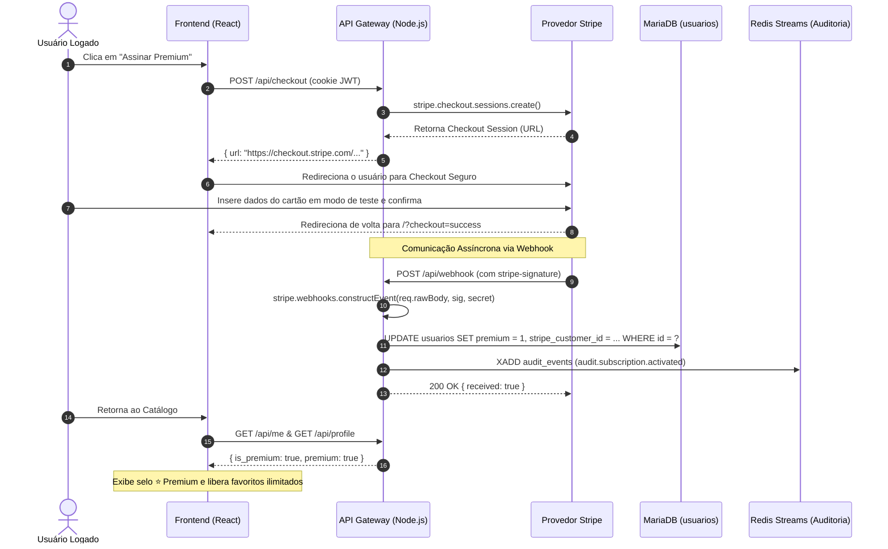
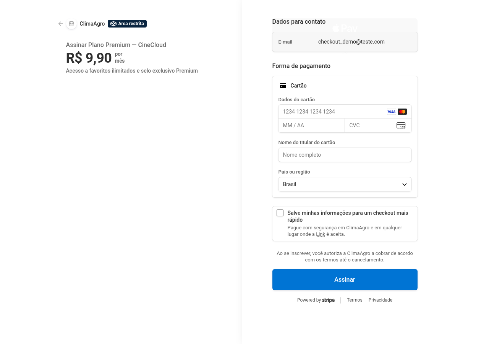
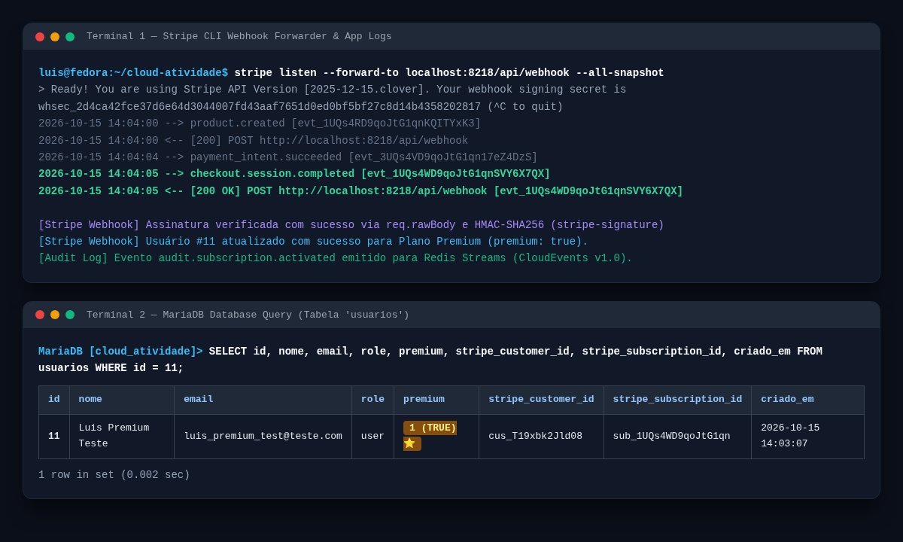
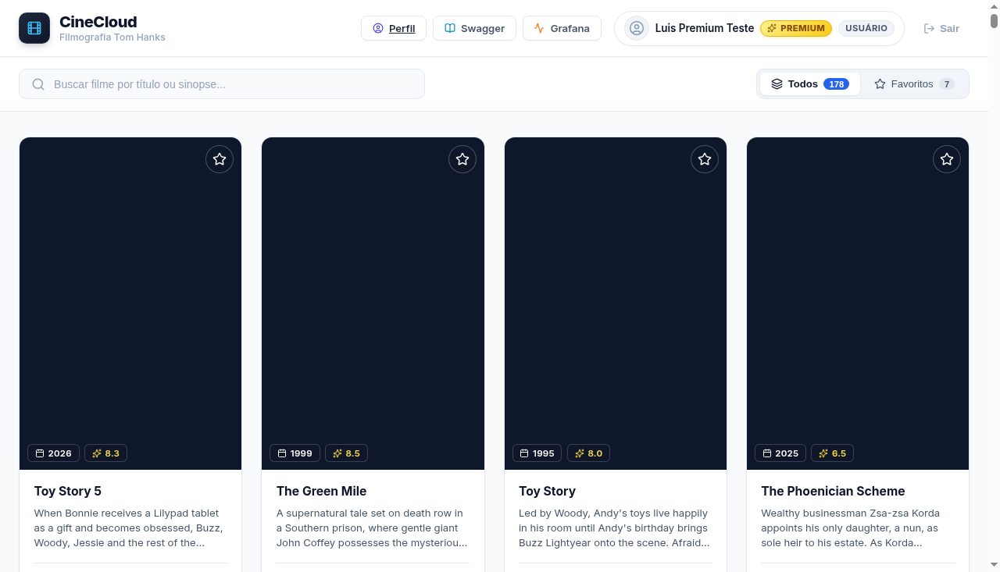
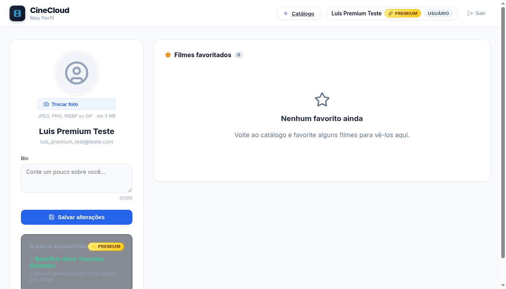
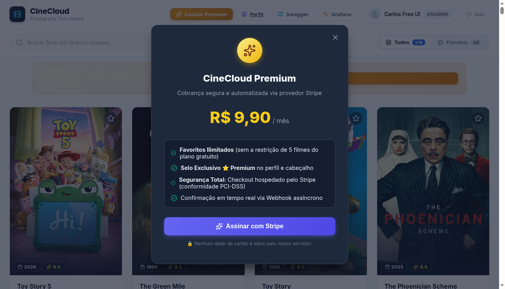

# Plano Premium com Stripe — Serviço Baseado em Pagamento (Atividade 7)

**Disciplina:** ISW055 · Introdução à Computação em Nuvem  
**Professor:** [github.com/siriani](https://github.com/siriani)  
**Atividade:** 7 — Serviço baseado em pagamento (Stripe)  
**Repositório:** [github.com/luisciaramicoli/cloud-atividade](https://github.com/luisciaramicoli/cloud-atividade)

---

## 1. Visão Geral e Modelo de Negócio

O CineCloud evoluiu de uma plataforma exclusivamente técnica para um modelo de negócio sustentável através da introdução do **Plano Premium**:
- **Plano Gratuito:** Usuários comuns podem explorar todo o catálogo da filmografia do Tom Hanks, avaliar e comentar filmes, porém possuem uma restrição contratual de no máximo **5 filmes favoritados**.
- **Plano Premium (R$ 9,90/mês):** Assinatura recorrente que desbloqueia **favoritos ilimitados** e concede o **selo exclusivo ⭐ Premium** visível no cabeçalho e na página de perfil.

---

## 2. Por que Pagamento é um Serviço à Parte (PCI-DSS & Segurança)

Armazenar ou manipular números de cartão de crédito, datas de validade e códigos CVV exige conformidade estrita com o padrão **PCI-DSS (Payment Card Industry Data Security Standard)**. Praticamente nenhum sistema web comum deve assumir essa responsabilidade, pois qualquer brecha ou vazamento de banco de dados acarretaria severas penalidades legais e financeiras.

### A Solução Adotada:
1. **Página Hospedada pelo Stripe (Stripe Hosted Checkout):** O usuário digita seus dados bancários diretamente na infraestrutura segura do Stripe.
2. **Zero Dados de Cartão no Backend:** Os números do cartão nem chegam ao nosso servidor. Nosso banco de dados guarda no máximo identificadores opacos (`stripe_customer_id` e `stripe_subscription_id`).
3. **Comunicação Assíncrona via Webhook:** A confirmação do pagamento é entregue pelo Stripe através de um webhook HTTP assinado digitalmente.



---

## 3. O que foi Implementado

### 3.1. Produto e Preço no Stripe (Modo de Teste)
- **Conta Stripe:** Vinculada em modo sandbox (`test mode`).
- **Produto:** `Plano Premium — CineCloud` (`prod_VRlWb9esmtjOyQ`).
- **Preço:** `R$ 9,90 / mês` recorrente (`price_1UQrzlD9qoJtG1qnrVYlB8lU`), moeda `BRL`.

### 3.2. Endpoint de Checkout (`POST /api/checkout`)
- **Arquivo:** `backend/src/controllers/paymentController.js`
- **Autenticação:** Protegido por JWT via cookie HttpOnly (`authenticateToken`).
- **Comportamento:**
  - Consulta o usuário no MariaDB para validar se ele já é assinante.
  - Cria uma `Checkout Session` no Stripe no modo `subscription`.
  - Configura `client_reference_id` e `metadata.userId` com o ID do usuário logado.
  - Define `success_url` (`/?checkout=success&session_id={CHECKOUT_SESSION_ID}`) e `cancel_url` (`/?checkout=cancel`).
  - Retorna o link seguro para redirecionamento.

### 3.3. Endpoint de Webhook com Validação Criptográfica (`POST /api/webhook`)
- **Arquivo:** `backend/src/controllers/paymentController.js`
- **Validação de Assinatura:**
  - O Express foi configurado em `backend/src/app.js` com middleware `verify` para capturar e preservar o `req.rawBody` bruto em `Buffer`.
  - O método `stripe.webhooks.constructEvent(req.rawBody, sig, STRIPE_WEBHOOK_SECRET)` valida a assinatura HMAC-SHA256 enviada no cabeçalho `stripe-signature`. Requisições forjadas ou sem assinatura válida são sumariamente rejeitadas com **HTTP 400**.
- **Processamento de Eventos:**
  - `checkout.session.completed`: Identifica o `userId` via `client_reference_id`, executa `UPDATE usuarios SET premium = 1, stripe_customer_id = ?, stripe_subscription_id = ? WHERE id = ?` e emite evento `audit.subscription.activated` para a stream do Redis.
  - `customer.subscription.deleted`: Em caso de cancelamento da assinatura pelo usuário ou pelo Stripe, atualiza `premium = 0` no MariaDB e registra o cancelamento na trilha de auditoria.

### 3.4. Benefício Real Comprovável (Usuário Comum vs. Premium)
- **Arquivo:** `backend/src/controllers/catalogController.js`
- **Regra de Negócio Implementada:**
  - Ao executar `POST /api/favorites`, o backend verifica se o usuário solicitante possui `premium = 1`.
  - **Usuário Comum (`premium = 0`):** É executado um `SELECT COUNT(*) FROM favoritos WHERE usuario_id = ?`. Se o usuário já possuir 5 favoritos cadastrados, a requisição é bloqueada com **HTTP 403 Forbidden**:
    ```json
    {
      "error": "Limite de 5 favoritos atingido para contas gratuitas. Assine o Plano Premium para favoritos ilimitados!",
      "limitReached": true,
      "maxFavorites": 5
    }
    ```
  - **Usuário Premium (`premium = 1`):** Não há trava de contagem; o usuário pode favoritar quantos filmes desejar (**favoritos ilimitados**).
  - **Identidade Visual:** Usuários premium recebem a insígnia dourada **⭐ Premium** no cabeçalho e na página de perfil, e a aba de favoritos remove o limitador `/5`.

---

## 4. Evidências e Comprovação Prática

### 📸 Print 1: Checkout do Stripe em Modo de Teste
Página oficial de checkout hospedada pelo provedor Stripe para o **Plano Premium — CineCloud** no valor de **R$ 9,90 por mês** em modo de teste:



---

### 📸 Print 2: Webhook Assíncrono e Atualização para `premium: true` no Banco
Terminal demonstrando a entrega do evento `checkout.session.completed` pelo Stripe CLI com status **200 OK**, validação de assinatura HMAC e a consulta direta no banco MariaDB demonstrando a coluna `premium = 1`:



---

### 📸 Print 3: Benefício Premium Ativo (Catálogo e Perfil)
Usuário Premium autenticado exibindo a badge dourada **⭐ PREMIUM**, ausência de limites e página de perfil com plano ativo:




---

### 📸 Print 4: Trava do Plano Gratuito (403 Forbidden) e Modal de Upgrade
Usuário gratuito atingindo o teto de 5 filmes favoritados, recebendo a trava de permissão e visualizando o modal de contratação do Plano Premium com integração direta ao Stripe:



---

## 5. Como Executar e Testar Localmente

1. Subir a stack com Docker Compose:
   ```bash
   docker compose up -d
   ```

2. Iniciar o encaminhador de webhooks do Stripe CLI:
   ```bash
   stripe listen --forward-to localhost:8218/api/webhook --all-snapshot
   ```

3. Simular o pagamento e ativação do plano premium para um usuário:
   ```bash
   stripe trigger checkout.session.completed --override checkout_session:client_reference_id=<USER_ID>
   ```

4. Rodar a suíte de testes automatizados de pagamentos e segurança:
   ```bash
   cd backend && npm test
   ```
